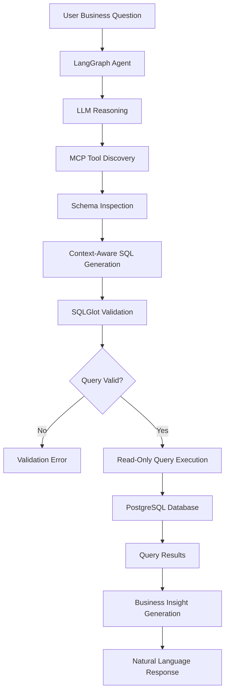

# AI Data Analyst Agent

### An Agentic AI System for Autonomous Database Analytics

**Turn natural-language business questions into validated SQL queries and actionable business insights.**

AI Data Analyst Agent is an end-to-end agentic analytics application that enables users to interact with relational databases using natural language. Instead of manually writing SQL, users can ask business questions and let an AI-powered agent discover database schemas, generate context-aware SQL, validate queries, execute them securely, and translate query results into meaningful business insights.

Built using **Python, LangGraph, LangChain, Model Context Protocol (MCP), FastMCP, and PostgreSQL**, the system combines LLM-powered reasoning with deterministic database tools to create a structured and controlled analytics workflow.

The goal is to bridge the gap between business intelligence and database engineering through an intelligent, tool-using AI agent.

---

## Key Capabilities

- **Natural Language to SQL:** Converts business questions into executable SQL queries using LLM-powered reasoning.
- **Autonomous Schema Discovery:** Dynamically discovers database tables and retrieves schema information before generating queries.
- **MCP-Based Tool Integration:** Connects the AI agent to database operations through standardized Model Context Protocol tools.
- **Schema-Aware SQL Generation:** Uses actual database structure and column metadata to generate contextually relevant queries.
- **SQL Validation and Guardrails:** Validates generated SQL using SQLGlot and enforces SELECT-only query execution.
- **Read-Only Database Execution:** Executes analytical queries through a restricted PostgreSQL connection.
- **Business Insight Generation:** Interprets query results and converts raw database output into human-readable business insights.
- **Agent Orchestration:** Uses LangGraph to coordinate LLM reasoning, tool invocation, and analytical workflows.
- **Automated Evaluation:** Includes an evaluation framework for testing SQL generation and analytical correctness against predefined business questions.

## System Architecture

The application follows a tool-driven agent architecture in which the LLM handles reasoning while deterministic tools handle database discovery, validation, and execution.

### Agent Workflow

1. **Question Understanding:** The agent receives a natural-language business question and determines the required analytical operation.
2. **Schema Discovery:** It uses MCP tools to discover available database tables and inspect their structures.
3. **SQL Generation:** The LLM generates SQL based on the question and retrieved schema information.
4. **Query Validation:** SQLGlot validates the generated query, while schema validation checks referenced database objects.
5. **Safe Execution:** Validated analytical queries are executed against PostgreSQL using a read-only database connection.
6. **Result Interpretation:** The agent analyzes the returned data and produces a natural-language business response.

## Technology Stack

| Category                 | Technologies                      |
| ------------------------ | --------------------------------- |
| Programming Language     | Python                            |
| Agent Framework          | LangGraph                         |
| LLM Integration          | LangChain                         |
| Agent Communication      | Model Context Protocol (MCP)      |
| MCP Server               | FastMCP                           |
| Database                 | PostgreSQL                        |
| Query Language           | SQL                               |
| SQL Parsing & Validation | SQLGlot                           |
| Evaluation               | Python-based evaluation framework |
| Testing                  | Pytest                            |

## MCP Database Tools

The application exposes database functionality through three MCP tools:

| Tool                 | Responsibility                                    |
| -------------------- | ------------------------------------------------- |
| `list_tables`        | Discovers available database tables.              |
| `describe_table`     | Retrieves table structure and column information. |
| `run_readonly_query` | Validates and executes read-only SQL queries.     |

This separation allows the agent to interact with the database through structured tool calls rather than unrestricted database access.

## Database Design

The project uses a PostgreSQL e-commerce analytics database named `ecommerce_analytics`.

It contains five relational tables:

| Table         | Description                                                |
| ------------- | ---------------------------------------------------------- |
| `customers`   | Customer information and attributes.                       |
| `products`    | Product details and categories.                            |
| `orders`      | Order records and transaction information.                 |
| `order_items` | Individual products, quantities, and prices within orders. |
| `payments`    | Payment records and payment statuses.                      |

The relational structure supports analytical questions involving product performance, customer behavior, sales trends, and payment-based revenue calculations.

## Database Security & SQL Guardrails

Generated SQL is treated as untrusted input. The application implements multiple layers of protection before executing database queries.

- **SQLGlot validation:** Parses generated SQL and enforces SELECT-only query restrictions.
- **Schema validation:** Checks generated queries against actual database structures.
- **Read-only database access:** Uses a restricted PostgreSQL database role and read-only transaction execution.
- **Query timeout:** Enforces a 10-second query execution timeout.
- **Result limiting:** Restricts query output to a maximum of 500 rows.
- **Controlled tool access:** Database operations are exposed through explicitly defined MCP tools.

These safeguards are designed to reduce unsafe query execution and prevent the AI agent from performing unintended database modifications.

## Example Use Cases

The agent is designed to answer business analytics questions such as:

| Business Question                                         | Analytical Task                       |
| --------------------------------------------------------- | ------------------------------------- |
| Which product category generates the highest gross sales? | Product category revenue aggregation  |
| What is the total revenue from completed payments?        | Payment-status-based revenue analysis |
| Which products generate the highest sales?                | Product performance analysis          |
| How does customer purchasing behavior vary?               | Customer-level aggregation            |

**Example interaction**

**User:**

> Which product category generates the highest gross sales?

**Agent workflow:**

- Discovers the `order_items` and `products` table structures.
- Generates a SQL query joining product and order item data.
- Validates the generated SQL.
- Executes the query using the read-only database tool.
- Identifies and explains the highest-performing product category.

The response includes the analytical result rather than simply returning an SQL statement.

## Evaluation & Testing

The project includes a dedicated evaluation framework to assess the reliability of the agent's analytical workflow.

The evaluation suite is designed around predefined business questions and expected analytical outcomes.

Key evaluation areas include:

- Natural-language question understanding.
- SQL query generation.
- Correct table and column selection.
- SQL
